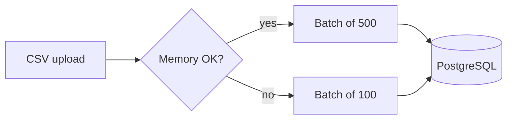

Intro paragraph with a [link to the docs](https://nodejs.org/api/process.html), an [internal link](/projects), and `inline code`.

## Code

```ts title="lib/queue.ts" {2}
export async function run(batch: number[]) {
  const results = await Promise.all(batch.map(work));
  return results.filter(Boolean);
}
```

## Diagram



## Media


<YouTube id="aqz-KE-bpKQ" title="Big Buck Bunny (sample video)" caption="YouTube via the privacy-enhanced domain" />

<Embed src="https://www.openstreetmap.org/export/embed.html?bbox=77.30%2C28.52%2C77.42%2C28.62&layer=mapnik" title="Map of Noida" aspect="4 / 3" caption="Generic iframe embed" />

## Callouts and tables

<Callout type="warning">
Available memory is a snapshot, not a promise.
</Callout>

<Callout type="tip" title="Rule of thumb">
Stream first, batch second.
</Callout>

| Free memory | Batch size |
| --- | ---: |
| < 256 MiB | 100 |
| ≥ 256 MiB | 500 |
